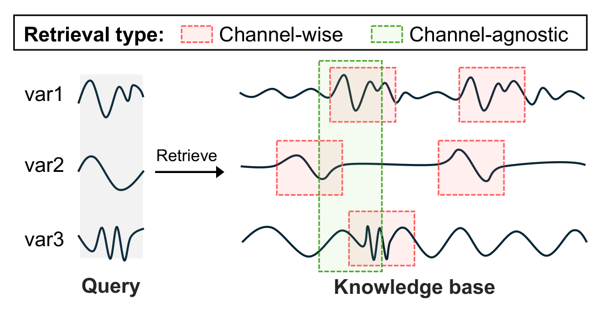
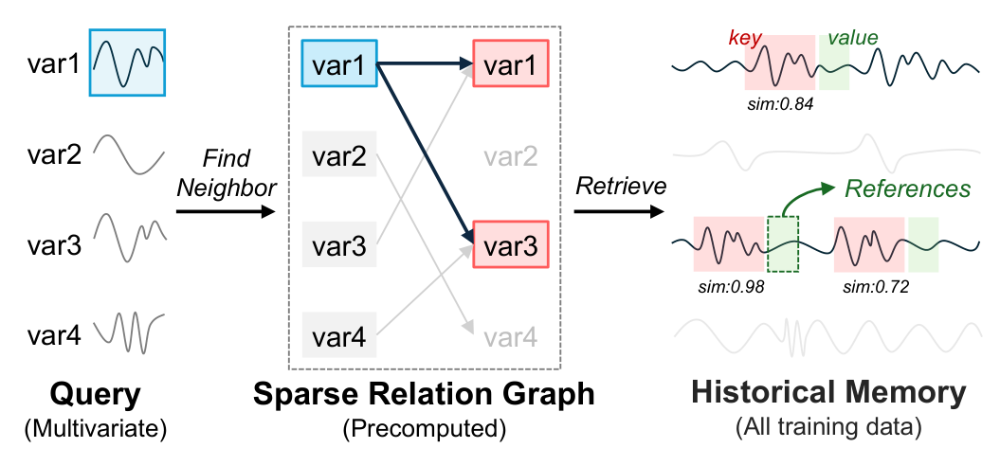

<div align="center">

# CRAFT: Channel-wise Retrieval for Multivariate Time Series Forecasting (ICASSP'26 Oral)

[](https://arxiv.org/abs/2604.05543)
[](https://arxiv.org/abs/2604.05543)
[](https://pytorch.org/)

**Channel-wise retrieval · Sparse relation graph · Spectral similarity**

</div>

> **TL;DR** Different variables have different periodicities, so they should not
> share one retrieved segment. CRAFT lets every variable retrieve its own
> references from history, and keeps this efficient with a sparse relation graph
> in the time domain and spectral matching in the frequency domain.

## Overview

Retrieval-augmented forecasting extends a fixed lookback window by retrieving
similar segments from the past. Existing methods are **channel-agnostic**: one
multivariate segment is retrieved and applied to all variables. **CRAFT**
(**C**hannel-wise **R**etrieval-**A**ugmented **F**orecas**T**ing) performs
retrieval **per variable**, so each one is matched with references that suit
its own dynamics.

<p align="center">
  
</p>

<p align="left"><em>
<b>Figure 1.</b> Comparison of retrieval strategies. In channel-agnostic retrieval,
all variables use the same retrieved multivariate segment. In channel-wise
retrieval (ours), each variable independently retrieves its own references,
respecting heterogeneity across variables.
</em></p>

## ⚙️ How it works

<p align="center">
  
</p>

<p align="left"><em>
<b>Figure 2.</b> Overall procedure of CRAFT. Each query variable first selects
related candidates through a precomputed sparse relation graph, then retrieves
variable-specific references from historical memory using spectral similarity.
</em></p>

1. **Sparse relation graph (pruning).** Each variable's trajectories over the
   training memory are concatenated, and every variable is linked to its top-$M$
   most similar variables by cosine similarity.
2. **Channel-wise knowledge base.** The first $F$ low-frequency FFT components of
   every candidate key are stored per variable.
3. **Spectral retrieval (ranking).** For each query variable, the spectrum of its
   lookback window is compared with its candidates by the normalized complex
   inner product
   $\mathrm{sim}(q_c, K_c) = \Re\lbrace q_c K_c^{*}\rbrace / (\lVert q_c\rVert \lVert K_c\rVert + \epsilon)$,
   and the futures of the top-$R$ keys are returned as references.
4. **Forecasting.** References are normalized by their last value, projected
   with a linear map, and averaged into $\hat{Y}_{\text{retrieval}}$. The final
   forecast is $\hat{Y} = \hat{Y}_{\text{direct}} + \alpha \cdot \hat{Y}_{\text{retrieval}}$,
   where $\hat{Y}_{\text{direct}}$ comes from any forecaster.

Because the relation graph restricts each variable to $M \ll C$ candidates and
the frequency cutoff reduces each comparison from $L$ to $F \ll L$ values, the
cost of retrieval drops from $O(C^2 \cdot |\mathcal{M}|)$ for naive channel-wise
retrieval to $O(C \cdot M \cdot F)$, linear in the number of variables.

## 📦 Installation

```bash
pip install git+https://github.com/junhyeokkang/CRAFT.git
```

Requires PyTorch ≥ 2.0 and NumPy.

## 🚀 Quick start

```python
from craft import CRAFT, build_memory

# train_series: (T, C) training split, scaled per channel.
keys, values, starts = build_memory(train_series, lookback_length=720, horizon=96, stride=10)

model = CRAFT(lookback_length=720, horizon=96)
model.build_memory(keys, values, starts)           # sparse relation graph + knowledge base

forecast = model(lookback_windows)                  # (B, 720, C) -> (B, 96, C)
```

During training, windows are cut from the same series as the memory. Pass their
start positions so that no window retrieves its own future:

```python
inputs, targets, input_starts = build_memory(train_series, 720, 96, stride=1)
loss = mse_loss(model(inputs[batch], query_starts=input_starts[batch]), targets[batch])
```

A complete training loop on synthetic data is in
[`examples/quickstart.py`](examples/quickstart.py).

<details>
<summary><b>API reference</b></summary>

<br>

| Object | Description |
|---|---|
| `build_memory(series, lookback_length, horizon, stride=10)` | Cuts a `(T, C)` series into `keys (N, L, C)`, `values (N, H, C)` and their `starts (N,)`. |
| `CRAFT(lookback_length, horizon, alpha=0.001, num_relations=3, num_references=1, num_frequencies=36, include_self=True, direct_forecaster=None)` | The full forecaster. `direct_forecaster` can be any module mapping `(B, L, C)` to `(B, H, C)`; the default is a two-layer MLP with last-value normalization. |
| `CRAFT.build_memory(keys, values, starts=None)` | Builds the relation graph and the knowledge base. |
| `CRAFT.forward(x, query_starts=None)` | Returns the forecast. Pass `query_starts` for training windows. |
| `ChannelWiseRetrieval(num_relations=3, num_references=1, num_frequencies=36, include_self=True)` | The retrieval module alone. `forward(query)` returns the retrieved keys and values, each `(C, B, R, ·)`. |

The defaults follow the paper: $M = 3$ related variables (the variable itself
included, as in Figure 2), $R = 1$ reference, $F = 36$ frequency components and
$\alpha = 0.001$; the paper uses a lookback of $L = 720$.

</details>

## 📝 Citation

If you find CRAFT useful, please cite our paper:

```bibtex
@inproceedings{kang2026channel,
  title     = {Channel-Wise Retrieval for Multivariate Time Series Forecasting},
  author    = {Kang, Junhyeok and Seo, Jun and Park, Soyeon and Han, Sangjun and Bae, Seohui and Choe, Hyeokjun and Lee, Soonyoung},
  booktitle = {ICASSP 2026 - 2026 IEEE International Conference on Acoustics, Speech and Signal Processing (ICASSP)},
  year      = {2026}
}
```
